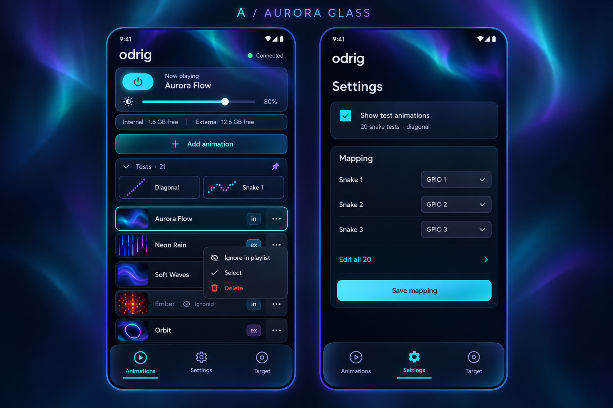

# Aurora Glass UI and playlist revamp

## Summary

Revamp the shared Android and emulator controller with the owner's chosen Aurora Glass
visual direction. Replace the separate Show and Storage screens with one Animations tab;
give GIF/MP4 conversion and upload its own Upload tab. Use four tabs: Animations, Upload,
Settings and Target. Settings replaces Mapping and contains mapping plus test visibility,
without duplicated playback controls.

Animation rows support long-press and drag to reorder, a small right-side `...` menu for
playlist inclusion and deletion, and compact `in` / `ex` storage badges. Preserve bulk
selection and deletion without competing with the long-press gesture. Twenty snake tests
and the diagonal appear in a pinned manual Tests group when enabled in Settings. These
21 tests never enter automatic playback.

## Priority

- `P1`

## Depends On

- Seeds 02, 03 and 04, for the shared player, emulator and firmware.
- Seed 09, for the shared operators' web app and Android package.
- Seed 17, for GIF/video conversion and uploading from the app.
- Seed 29, for persisted inclusion, bulk deletion and internal/external capacity.
- Seed 30, for editable mapping and the built-in diagonal diagnostic.

## Product Context

The owner finds the existing UI unattractive and its workflow repetitive: Show and
Storage repeat animation lists and capacity, and Mapping repeats power and brightness.
The owner selected mockup A, Aurora Glass, on 2026-10-24, then explicitly confirmed that
the test checkbox controls manual-test visibility only: all tests stay out of autoplay.
The later decision to give uploads their own tab supersedes the three-tab mockup.

The aim is one coherent operator workflow, not a theme change alone. Existing inclusion,
deletion, upload, mapping and target controls remain available through clearer navigation.
Saved reordering and twenty per-snake diagnostic entries are functional work in this seed,
alongside the presentation changes and the existing diagonal.

## Chosen Visual Reference

The image beside this seed is the exact selected generated mockup, tracked with the seed.
Use its midnight background, teal/violet aurora accents, restrained glow, translucent
panels, rounded surfaces and clear light text as implementation inspiration.

The written behavior in this seed takes precedence over incidental image details:

- There are four tabs, including Upload; the image predates that decision.
- Storage numbers and brightness shown in the image are illustrative, not defaults or
  reported board facts. Render actual target state and the existing brightness scale.
- Mutations on external media are not enabled by a menu drawn in a mockup.
- Do not infer extra app features from decorative imagery. Preserve readable contrast
  and practical touch targets rather than reproducing every glow or surface effect.

## Technical Constraints

- Implement navigation, styling and interactions once in `app/www/`. The APK, browser
  app and emulator Controller view consume that same source. Do not build another
  controller or duplicate playlist behavior in an emulator-specific page.
- Playback order, durable mutations, diagnostic selection and their command semantics
  belong to the shared C++ core. Firmware and emulator hosts carry commands and apply
  outputs; the app displays confirmed target state. Reordering is not a local visual sort.
- Follow the existing single command list and implementation for serial, HTTP Wi-Fi,
  emulator TCP, `odrigctl`, Android and browser control. Specify the necessary shared
  order and diagnostic operations during seed-to-spec, with owner approval for command
  additions and relevant decision changes before implementation. This seed adds no
  commands or protocol members itself.
- Keep existing command/reply limits, pagination, memory bounds and durable-storage
  guarantees. Use the established converter for encoded animation assets; do not add a
  second converter or separate diagnostic LED driver.
- Determine `in` / `ex` from authoritative source information, not a numeric id range:
  installed ids can overlap the range often used by external animations.
- External files remain read-only. No external deletion or inclusion mutation is added.
  Reordering policy for external entries is the explicit open question below; do not
  implement a guessed policy or write playlist metadata onto external media.
- Preserve off state, brightness and current limiting when selecting a test or changing
  the order. No wiring, power, pin-set or storage-layout changes belong to this seed.
  Any later board work follows the existing tools and brightness limit of 40.

## Required Behavior

### Navigation and shared controls

1. The bottom navigation has Animations, Upload, Settings and Target. Show and Storage
   no longer exist as separate tabs. Mapping is a section of Settings.
2. Animations has one list for playback and management, one compact now-playing/state
   area, power and brightness controls, and the playlist-from-start action. Avoid
   duplicated lists, inclusion controls and capacity readouts within this workflow.
3. Show internal and external free/total space compactly in Animations, with clear absent
   versus unavailable external capacity. Retain updates after boot/reconnect, uploads
   and deletions, including uncertain outcomes, and the normal active-view refresh.
   Upload may use the same capacity state for its fit checks without a second model.
4. Remove the duplicated On/Off buttons, brightness slider and other Show controls from
   Settings/Mapping. Mapping retains its saved-assignment editor, draft/Save/Cancel,
   defaults, conflict recovery and routing semantics from seed 30. Ordinary playback
   controls remain in Animations; Settings does not gain another copy.
5. Upload owns GIF and MP4 selection, conversion, fitting/cropping and part selection,
   preview, upload progress/speed and cancellation. Preserve the existing supported
   media behavior. Conversion and upload no longer sit under the animation list.
   A compact Add animation action in Animations may navigate to Upload.
6. Target retains address/connection controls and useful connection information. The
   new four-tab navigation preserves back behavior, phone system-bar clearance,
   keyboard handling and readable error/recovery messages.

### Animation rows and management

7. Each ordinary row identifies the animation and has a small two-letter `in` or `ex`
   source badge. The badges mean internal and external storage and have accessible
   full descriptions. Keep the layout compact; long filenames remain identifiable.
8. Tapping an animation explicitly plays it. A small right-side `...` button opens its
   action menu without also playing the row. Replace the regular Include in playlist
   checkbox and repeated per-row Remove button with that menu.
9. For internal animations, the inclusion action is Ignore in playlist when included,
   and Restore to playlist when ignored. Retain seed 29 semantics: the file stays,
   explicit play works, automatic playback skips ignored entries, explicit cycles are
   unaffected, and inclusion survives restart and unrelated mutations.
10. Keep ignored entries identifiable with text/icon treatment as well as restrained
    visual muting. Pending inclusion changes cannot look confirmed; refusal or an
    uncertain reply triggers readable recovery and an authoritative refresh.
11. Internal rows offer Delete with confirmation. External rows have no enabled Delete
    or inclusion action; explain their read-only status where needed. Existing cycle
    reference restrictions and core validation still apply to internal deletion.
12. Preserve multi-selection, Select all, Clear selection and Delete selected in the
    unified list. Enter selection mode through an explicit Select action/menu or
    clearly labelled control; reserve long-press for reordering. Selection controls
    may appear within this mode without restoring always-visible inclusion checkboxes.
13. Bulk deletion still confirms the count and filenames, uses the established bounded
    batches, disables conflicting actions, reports partial completion and refreshes
    list/capacity. Never blindly retry an uncertain deletion. Reconcile selection with
    the target and clear it when switching targets.

### Saved playlist ordering

14. Long-pressing an eligible ordinary item lifts it for drag reordering. Give clear
    feedback and a destination placeholder; support scrolling through a long list
    while dragging. Provide equivalent mouse interaction in the emulator and an
    accessible alternative that does not require a touch long-press.
15. A completed move saves the order on the target through the shared protocol. A
    restart, app reload, second controller or serial query sees the same order.
    Preserve item identities, files and inclusion flags; ignored items keep their
    place in the editable list while remaining skipped by automatic playback.
16. Reordering preserves the current animation's turn, power and brightness. Subsequent
    automatic progression and playlist-from-start use the saved order. Do not rewrite
    the explicit sequence inside a cycle as a side effect of dragging a playlist row.
17. Show pending/saved/failure state truthfully, recover after a refused or lost reply,
    and detect concurrent order changes rather than silently overwriting another
    controller's edit. A cancelled drag changes nothing. Define safe interaction with
    uploads, deletion, target switches and diagnostics in the spec.
18. The external-entry ordering decision below must be resolved before this behavior is
    specified for external rows. Never imply that an unsupported drag has been saved.

### Manual test animations

19. Settings has a checkbox labelled Show test animations, with a description such as
    20 snake tests + diagonal. This is a visibility preference, not an inclusion flag.
    Remember it across app reload; default to hiding tests for ordinary operation.
20. When enabled, a distinct pinned Tests group is above ordinary animations in the
    Animations tab. It contains exactly twenty labelled snake tests and the existing
    diagonal test. It may collapse for space, but every one of the 21 entries is
    reachable. When disabled, those entries are hidden from the ordinary list.
21. A Snake N test manually identifies that one logical three-strip snake through the
    currently saved mapping while other snakes are dark. Reuse the existing diagonal's
    one-white-pixel-wide bottom-left-to-top-right line for the twenty-snake canvas.
    Unsupported mappings get a clear explanation rather than an invented mapping.
22. All 21 tests are manual-only service animations. They never join autoplay, startup
    selection, playlist wraparound, explicit user cycles or a reordered ordinary
    playlist, whether visible or hidden. They are not ordinary uploaded animations,
    require no operator uploads, and cannot be deleted, ignored, bulk-selected or
    dragged into the user playlist.
23. Use shared diagnostic playback and state across controllers. Show which test is
    active and provide an explicit way to stop it and resume normal playback; ordinary
    Play also exits testing. Preserve the established diagnostic power/brightness and
    restart behavior. Changing tabs or test visibility must not make an active test
    impossible to identify or stop. Software cannot certify real wiring by itself.

## Definition Of Done

1. One requirements/design/tasks set covers the entire revamp, including the fourth
   Upload tab, saved order and manual test group. Resolve the external-ordering owner
   question and obtain necessary shared-command/decision approvals before implementation.
2. The same implementation works in Android and the emulator Controller view. Browser
   tests cover the four tabs, menu actions, ignored states, bulk selection/deletion,
   upload/conversion, drag and alternate ordering input, long lists, errors, target
   changes and phone portrait/landscape layouts. Existing accessibility, long-press
   text suppression, system-bar and keyboard behavior remain correct.
3. Shared-core and route tests cover persisted order, restart, stale edits, interrupted
   commits and recovery. Verify equivalent order and diagnostic behavior on HTTP,
   serial, TCP and `odrigctl`, without transport-specific playlist implementations.
4. Verify all 21 manual tests, their saved-mapping output, visibility persistence,
   start/stop and exit behavior, and their exclusion from every automatic path.
   Preserve the existing mapping, inclusion, capacity and deletion regressions.
5. Run all locally supported suites and build the APK and relevant firmware variants
   with repository tools during implementation. Record actual results and limitations.
   Owner phone/real-LED checks remain explicit acceptance work; software screenshots
   or emulator tests alone do not establish physical wiring or phone behavior.
6. This seed-creation commit contains only this seed folder, its state and the selected
   mock image. It creates no spec, queue tasks, implementation or new build artifacts.

## Open Questions

1. **External animation reordering.** Should external rows stay after the ordered
   internal playlist in their existing external-media order, with dragging limited
   to internal items, or should operators be able to persist one interleaved order
   containing internal and external entries? The latter also needs an agreed identity
   and recovery policy when media is unplugged, changed or reconnected. This remains
   an owner choice; the brainstorming did not approve either policy.

The chosen Aurora Glass direction, four tab names, separate Upload workflow, row menu,
two-letter source badges, removal of duplicated controls and manual-only test visibility
are settled. Exact protocol syntax and implementation structure belong to seed-to-spec,
subject to the repository's owner-approval rules; no implementation is authorized by this
planning commit.
