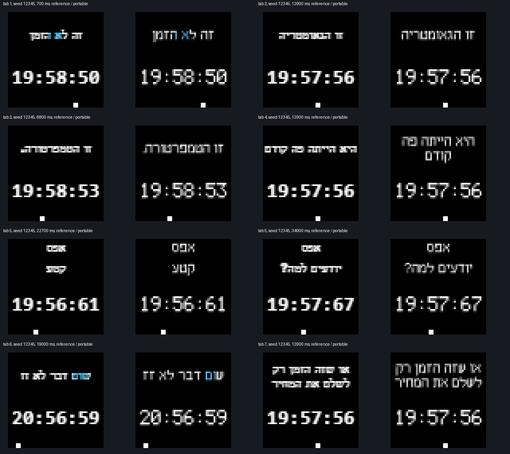

# Seven message-clock widgets

The retained HTML in `../references/` is the source of all wording, punctuation,
sequence order, special roles and default timings. `manifest.json` pins its SHA-256,
the existing authored font and the seven complete loops. The generator parses the
pinned data array; it does not execute the supplied script.

From the repository root, generate sources into an ignored folder:

```sh
node project-seeds/59-p2-message-clock-widgets-and-clocks-only-mode/source/generate.mjs build/message-widgets/source
```

For each generated `v7-NAME.json`, use the project's converter:

```sh
node converter/odrig.js encode build/message-widgets/source/v7-NAME.json collection/card/clocks/message/v7-NAME.odrgx
node converter/odrig.js thumbnail collection/card/clocks/message/v7-NAME.odrgx --catalog thumbnails --card collection/card --beside
```

The standard preview samples across the complete loop and runs faster than playback.
It is not the animation's timeline. The longest widget is 76.9 seconds; its payload
is 22,495 bytes. No rendered video or captured frame stream is stored in a widget.
The old `its-not-the-time` animation and its companions are unchanged.

## Visual comparison and adaptations

Run the reproducible review, using the same headless Chrome harness as the app suite:

```sh
python -m tests.app.message_review build/message-widgets/review
```

This runs the retained page's text rasterizer, timeline, rolling wheels and motion.
Only its clock, random source and final decorative dot canvas are instrumented.
The seed is 12345. Every caption is sampled 700 ms after its start; additional
consciousness samples cover slowing and completed stop: 58 source/widget pairs.
Seven complete contact sheets and raw RGB pairs are written under the output folder.
`review.json` records the source state at each sample. `comparison.png` shows eight
representative pairs, source on the left and portable widget on the right.



The comparison was inspected for RTL, punctuation, long two-line wrapping, the
three zero subtitles, the moving square, frozen motion and digit-wheel placement.
The first trial's digits filled the 16-row wheel window and appeared too large.
The delivered atlas centers a 12-pixel font in that window, matching the reference's
font size and leaving space around stationary digits. A regression observed the
trial glyph's excessive height before this correction.

The source uses Arial for Hebrew and 12px monospace for time. Widgets reuse the
project's existing small Hebrew and large digit fonts; no language or font support
is added. Text is area sampled at horizontal scale 0.8 and vertical scale 8/9,
with fixed 9-pixel line spacing and at most two lines. Digits use 0.6 and 2/3.
Existing-font metrics can wrap at a different word from Arial; all text remains
present, at one fixed size. Masks are alpha4, so antialiasing differs from Chrome.
The black physical background omits unlit-dot outlines and the page background.

Source `Date` and `Math.random` become the existing seeded virtual-time convention.
The review feeds the page the same initial virtual time and random stream. Its
20ms integration and floating-point caption transitions can differ slightly from
the renderer's analytic, integer-millisecond slowdown. Clock and square stop
together after 3.5 seconds; rolling digits finish fully and remain steadily lit.
Square position is rounded to an LED; a freeze captures the deterministic position
at the caption boundary rather than the previous browser refresh. Each widget
restarts its own tab after its complete loop instead of advancing to the next tab.

Converter tests independently read the reference captions and role flags, pin source
and font hashes, reproduce delivered bytes and previews, and check digit size.
The core compares actual delivered pixels with the converter at caption, roll,
stop and loop boundaries for two seeds. Both schedulers play every delivered tab
to its end. The live emulator verifies manual playback with messages disabled,
ancestor exclusions, recovery and an unchanged card. Physical LED and phone
acceptance remain open in the spec's final task.

`delivery.json` records the 21 delivered asset/preview/readme SHA-256 hashes after
copy and readback from the share resolved through `ODRIG_ANIMATIONS` in `env`.
